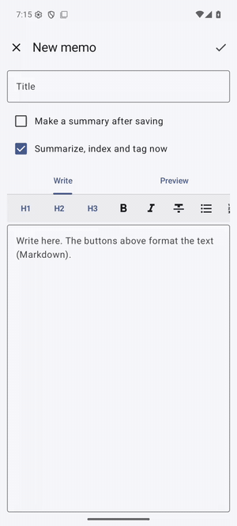

# 조각보 (Jogakbo)

[English](README.md)

AI가 폰 안에서 돌아가는 안드로이드 노트 앱입니다. 직접 쓴 메모, 웹페이지, 유튜브 영상, 녹음을 모으고, 노트마다 위에 요약, 아래에 원문을 둡니다. **조각보**는 자투리 천을 이어 만든 보자기입니다. 웹, 영상, 녹음, 메모의 조각을 한곳에 모아 찾아볼 수 있게 합니다. *Journal Of Gathered Audio, Knowledge, Bookmarks & Originals.*

<p>

</p>

*메모를 폰에서 요약하고 태그를 붙이며, 의미로 찾습니다("휴가 때 산에 가는 일정"으로 제주 여행 계획을 찾음).*

| 부분 | 앱 | 하는 일 |
|---|---|---|
| 노트 | **조각보** (이 저장소) | 노트, 요약, 녹음, 검색, 내보내기·가져오기 |
| AI 모델 | [온돌샘](https://github.com/sonanjip/ondolsaem) (AI 기능에 필요) | 언어 모델(요약), 음성 인식, 임베딩 모델(검색), 판단 모델(태그)을 폰에서 실행 |
| 채팅 | [말벗다리](https://github.com/sonanjip/malbotdari) (선택) | 조각보 SDK로 채팅에서 노트를 검색하고 읽음 |

## 기능

| 기능 | 설명 |
|---|---|
| 메모 | 서식 도구 모음(제목, 굵게, 목록, 체크리스트, 인용, 코드, 링크)과 미리보기가 있는 마크다운 노트, 원하면 요약 |
| 웹페이지 | 링크를 공유하거나 붙여 넣으면 본문을 마크다운으로 뽑아 요약 |
| 유튜브 | 제목, 채널, 설명, 자막(직접 단 것 또는 자동 생성)을 저장하고 요약. 자막 줄을 누르면 그 시각부터 영상이 열림 |
| 문서 | 텍스트, 마크다운, PDF, Word, PowerPoint, Excel, OpenDocument 파일을 첨부(또는 공유)하면 글자를 읽어(텍스트 층이 없는 쪽은 온돌샘의 글자 인식) 쪽·슬라이드·시트별 구간으로 보관. 긴 문서는 부분별로 요약한 뒤 다시 합쳐 요약하고, 구간마다 검색됩니다 |
| 이미지와 공유 | 선택한 글자나 텍스트·오디오·이미지·문서를 공유. 여러 항목은 각각 노트로 만들고 이미지의 글자를 기기에서 인식 |
| 녹음 | 앱에서 녹음(녹음하는 동안 받아쓴 줄이 차례로 나타남)하거나 오디오 파일을 가져와 받아쓰고 요약. 줄을 누르면 그 위치부터 재생 |
| 요약 | 모든 요약에 쓸 지시문과 요약마다 쓸 지시문, 원문 언어 또는 앱 언어. 요약은 고칠 수 있고, 고친 요약을 다시 요약할 때는 먼저 묻습니다 |
| 검색 | 의미(폰에서 만든 임베딩, 시점은 설정에서 선택: 바로, 충전 중이고 쓰지 않을 때, 하루 한 번, 직접. 노트마다 따로 정할 수도 있음)와 단어로 |
| 태그 | 나만의 태그(예시 포함: 업무, 공부, 아이디어, 여행, 건강, 돈, 요리)와 선택 설명. 온돌샘의 판단 모델이 임베딩 시점에 노트마다 태그별로 확인하고, 불확실한 태그는 노트에서 제안. 직접 붙이거나 뗀 태그는 그대로 유지. 목록을 태그로 거르기 |
| 내보내기·가져오기 | 노트마다 마크다운 파일 하나(태그 포함)와 태그 목록이 든 ZIP(원하면 오디오 포함). 그런 ZIP이나 마크다운·텍스트 파일을 가져옴(front matter의 태그도 읽음) |
| 다른 앱 | 말벗다리(와 허용한 앱)가 SDK(`:sdk`)로 노트를 검색하고 읽음 |

영어·한국어 UI, 다크 모드.

## 요구 사항

Android 10 이상(minSdk 29). 온돌샘에 언어 모델(요약), 음성 인식 모델(녹음), 임베딩 모델(의미 검색)이 있어야 합니다. 메모 쓰기, 링크 저장, 단어 검색, 내보내기는 온돌샘 없이도 됩니다.

## 빌드

```sh
source scripts/env.sh
./gradlew assembleDebug        # app/build/outputs/apk/debug/app-debug.apk
```

온돌샘 SDK는 JitPack에서 받습니다. 형제 폴더의 소스로 빌드하는 법은 [docs/development.md](docs/development.md).

## 문서

[사용 안내](docs/user-guide.md) · [구조](docs/architecture.md) · [노트 SDK](docs/notes-sdk.md) · [개인정보](docs/privacy.md) · [개발](docs/development.md) · [로드맵](docs/roadmap.md)

## 이름의 뜻

**조각보**는 **조각**과 **보**(보자기)를 합친 말로, 자투리 천 조각을 이어 붙여 만든 우리 전통 보자기입니다. 조각보 앱도 정보를 그렇게 다룹니다. 웹페이지, 유튜브 영상, 녹음, 직접 쓴 메모의 조각들을 한곳에 이어 붙여 다시 찾을 수 있게 하고, 조각마다 요약 아래에 원문을 그대로 남깁니다. 온돌샘의 *온돌*처럼 한옥 살림살이에서 온 이름이고, 다른 앱들처럼 영어로도 발음하기 쉬운("jo-gak-bo") 두 단어의 조합입니다.

역두문자는 이름 전체를 풉니다: **J**ournal **O**f **G**athered **A**udio, **K**nowledge, **B**ookmarks & **O**riginals.

## 라이선스

Apache License 2.0. [LICENSE](LICENSE)와 [THIRD_PARTY_NOTICES.md](THIRD_PARTY_NOTICES.md) 참고.

공유 항목은 최대 10개를 골라 가져오며 파일은 각각 100 MiB, 전체 200 MiB까지 허용합니다.

공유한 텍스트는 메모로 편집할 수 있고 선택한 글자도 Android 텍스트 메뉴에서 보낼 수 있습니다. 오디오, 이미지 또는 지원하는 문서 파일을 여러 개 공유하면 각각 별도 노트로 만듭니다. 이미지는 온돌샘으로 글자를 인식하며 원본도 보관합니다.
