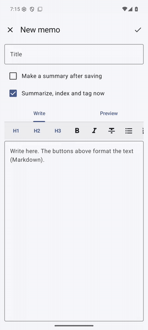

# Jogakbo (조각보)

[한국어](README.ko.md)

An AI note app for Android whose AI runs on the phone: memos you write, web pages, YouTube videos and recordings, each with a summary on top and the original below. A **조각보** (jogakbo) is a Korean wrapping cloth sewn from scraps: scraps from the web, videos, recordings and your own memos become one place to look things up. *Journal Of Gathered Audio, Knowledge, Bookmarks & Originals.*

<p>

</p>

*A memo gets an on-device summary and tags, and is found by meaning ("a vacation schedule in the mountains" finds the Jeju trip plan).*

| Part | App | What it does |
|---|---|---|
| Notes | **Jogakbo** (this repository) | Notes, summaries, recordings, search, export and import |
| AI models | [OndolSaem](https://github.com/sonanjip/ondolsaem) (required for AI) | Runs the language model (summaries), speech recognition, the embedding model (search) and the decision model (tags) on the phone |
| Chat | [Malbotdari](https://github.com/sonanjip/malbotdari) (optional) | Searches and reads your notes in a chat through Jogakbo's SDK |

## Features

| Feature | What it does |
|---|---|
| Memos | Markdown notes with a formatting toolbar (headings, bold, lists, checklists, quotes, code, links) and a preview; optional summary |
| Web pages | Share or paste a link: the article is extracted as Markdown and summarized |
| YouTube | Title, channel, description and subtitles (manual or generated) are saved and summarized; tapping a subtitle line opens the video at that time |
| Documents | Attach a text, Markdown, PDF, Word, PowerPoint, Excel or OpenDocument file (or share one to the app): the text is read (pages without a text layer by OCR in OndolSaem) and kept as sections per page, slide or sheet; long documents are summarized in parts, then the parts together, and every section is searchable |
| Images and sharing | Select text or share text, audio, images and documents; multiple items create separate notes, and images are read by on-device OCR |
| Recordings | Record in the app (the transcript appears line by line while recording) or import an audio file; the transcript is summarized; tap a line to play from there |
| Summaries | Your own instructions for every summary and for each one; language of the original or of the app; summaries can be edited, and summarizing again asks before replacing an edited one |
| Search | By meaning (embeddings made on the phone, at a time you choose: right away, while charging and unused, daily, or by hand; each note can override the default) and by words |
| Tags | Your own tags (examples included: work, study, ideas, travel, health, money, cooking), each with an optional description. OndolSaem's decision model checks every note against every tag at the embedding time; unsure tags are offered on the note; tags you add or remove stay. Filter the list by tag |
| Export and import | A ZIP with one Markdown file per note (with its tags) and the tag list (and the audio if you like); imports such a ZIP or any Markdown or text file (tags in front matter are read too) |
| Other apps | Malbotdari (and apps you allow) search and read notes through the SDK (`:sdk`) |

English and Korean UI, dark mode.

## Requirements

Android 10 or newer (minSdk 29). OndolSaem with a language model (summaries), a speech recognition model (recordings) and an embedding model (search by meaning); writing, saving links, word search and export work without it.

## Build

```sh
source scripts/env.sh
./gradlew assembleDebug        # app/build/outputs/apk/debug/app-debug.apk
```

The OndolSaem SDK comes from JitPack; to build against a sibling checkout see [docs/development.md](docs/development.md).

## Docs

[User guide](docs/user-guide.md) · [Architecture](docs/architecture.md) · [Notes SDK](docs/notes-sdk.md) · [Privacy](docs/privacy.md) · [Development](docs/development.md) · [Roadmap](docs/roadmap.md)

## About the name

**조각보 (Jogakbo)** joins **조각** (*jogak*, a piece or scrap) and **보** (*bo*, a wrapping cloth). A jogakbo is a traditional Korean wrapping cloth sewn together from leftover scraps of fabric. Jogakbo the app does the same with information: scraps from web pages, YouTube videos, recordings and your own memos are stitched into one place where you can find them again, and each piece keeps its original under a summary. It continues the household theme of its siblings (the *ondol* floor of OndolSaem) and, like them, is two everyday Korean words easy to say in English ("jo-gak-bo").

The backronym covers the whole name: **J**ournal **O**f **G**athered **A**udio, **K**nowledge, **B**ookmarks & **O**riginals.

## License

Apache License 2.0, see [LICENSE](LICENSE) and [THIRD_PARTY_NOTICES.md](THIRD_PARTY_NOTICES.md).

Before importing shared files, choose up to 10 items; files are limited to 100 MiB each and 200 MiB total.

Shared text can be edited as a memo; selected text can be sent through Android’s text actions. Share one or several audio, image or supported document files to create separate notes. Images are read with OndolSaem OCR and the original is kept with the note.
